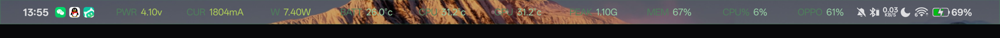
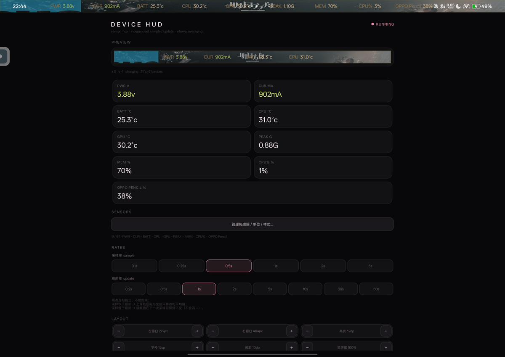
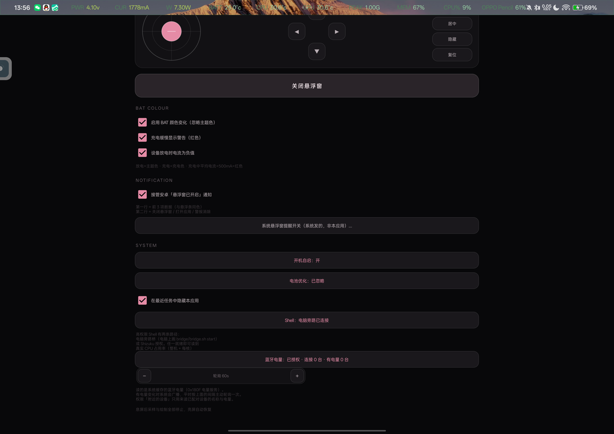

# DeviceHud

把设备的实时状态压进一条可以悬浮在状态栏上的信息条。



纯 Java 手写 View，**不依赖 AndroidX / Compose / Material**，整个 App 只有 Shizuku 一个可选依赖。
适用于想把 CPU 频率、温度、功耗、内存这些数据常驻在屏幕顶部的人——打游戏、跑分、压测、或者单纯想看着舒服。

> 目前只在 OPPO / 一加（ColorOS，Android 16）上实测过。其它 ROM 的数据源可用性会有差异，见「已知限制」。

## 特性

- **悬浮条覆盖在状态栏上**：`TYPE_APPLICATION_OVERLAY` + `FLAG_NOT_TOUCHABLE`，视觉上压在状态栏图标下层，触摸完全穿透，不影响正常操作
- **指标可自选**：启动时探测设备上所有 thermal zone，本机探出 84 个可用传感器，任意挑 9 个显示
- **8 核频率柱状图**：逐核实时频率，大核小核一眼分辨
- **位置可调**：方向键 1px 步进、摇杆按幅度 1~6px/帧，带浮点累积，不会因为取整丢步
- **5 套配色**：INK / AMBER / ICE / MONO / PHOSPHOR，只换颜色不改排版
- **自定义背景图**：可以从相册选图并裁切，条子底下垫自己的壁纸
- **采样与刷新解耦**：采样 0.5s~60s、界面刷新 0.2s~60s 各自独立，采样快刷新慢时显示窗口均值
- **蓝牙电量**：读已配对耳机的剩余电量
- **开机自启**（可选）

## 截图

| 主界面 | 设置 |
|---|---|
|  |  |

## 构建

**环境**

| 项 | 版本 |
|---|---|
| JDK | 17+ |
| Android SDK | compileSdk 36、build-tools 36 |
| Gradle | 9.6.0（已带 wrapper） |
| AGP | 9.5.1 |
| minSdk | 30（Android 11） |

```bash
git clone https://github.com/zuoyexingchen-uw4r/DeviceHud.git
cd DeviceHud

# 指向自己的 SDK
echo "sdk.dir=/path/to/Android/Sdk" > local.properties

./gradlew assembleDebug
# 产物：app/build/outputs/apk/debug/app-debug.apk
```

国内网络拉 Gradle 发行版慢的话，把 `gradle/wrapper/gradle-wrapper.properties` 里的
`distributionUrl` 换成腾讯云镜像：

```
https://mirrors.cloud.tencent.com/gradle/gradle-9.6.0-bin.zip
```

### 签名的 Release 构建

release 签名从仓库根的 `keystore.properties` 读取，**该文件与 keystore 本身都不入库**：

```properties
storeFile=../keystore/devicehud-release.jks
storePassword=******
keyAlias=devicehud
keyPassword=******
```

文件不存在时 `assembleRelease` 照常跑通，只是产出 `app-release-unsigned.apk`——
所以别人克隆下来无需任何私密文件即可编译。

自己生成一份密钥：

```bash
keytool -genkeypair -v \
  -keystore keystore/devicehud-release.jks \
  -storetype PKCS12 -alias devicehud \
  -keyalg RSA -keysize 4096 -validity 10000 \
  -dname "CN=DeviceHud, O=your-name, C=CN"
```

> ⚠️ **keystore 丢失 = 永远无法给已发布的版本推升级。**
> Android 靠签名证书判断「是不是同一个应用」，证书变了系统就当成另一个 App。
> 请离线备份（网盘 / 密码管理器），切勿提交到仓库。

CI 签名需要四个 Secrets，未配置时自动跳过 release 构建：

| Secret | 内容 |
|---|---|
| `KEYSTORE_BASE64` | `base64 -w0 keystore/devicehud-release.jks` 的输出 |
| `KEYSTORE_PASSWORD` | storePassword |
| `KEY_ALIAS` | keyAlias |
| `KEY_PASSWORD` | keyPassword |

## 使用

仓库提供两种构建，包名不同，**可以同时装在一台手机上**：

| 构建 | 包名 | 说明 |
|---|---|---|
| `assembleRelease` | `io.github.zuoyexingchen.devicehud` | 正式版 |
| `assembleDebug` | `io.github.zuoyexingchen.devicehud.debug` | 内测版，桌面显示为 DeviceHud Debug |

两者代码完全相同，debug 版只是通过 `applicationIdSuffix` 派生出独立包名，
因此配置、数据互不干扰，也不会互相覆盖。

1. 安装后首次打开，授予**悬浮窗权限**（也可以用 `adb shell appops set io.github.zuoyexingchen.devicehud SYSTEM_ALERT_WINDOW allow` 跳过手动点）
2. Android 13+ 会再要一次通知权限（前台服务需要）
3. 点「开启悬浮窗」，条子会出现
4. 用方向键 / 摇杆把它挪到状态栏位置，点「贴顶」可自动对齐
5. 进「管理传感器」，勾选想看的指标

## 高权限数据（可选）

`untrusted_app` 身份读不到 `/proc/stat`，所以**真实 CPU 占用率**默认拿不到。两条路，都不需要 root：

### 1. Shizuku

装了 [Shizuku](https://shizuku.rikka.app/) 并在应用内授权后，`ShellAccess` 会自动走 Shizuku 通道。

### 2. 有线旁路 Shell 桥

不想装 Shizuku 的话，`bridge/` 下有一套用 adb 起 `app_process` 的旁路方案：
借 shell (uid=2000) 身份在设备上开一个回环端口，应用连上去就能以 shell 权限执行命令。
握手用一次性 token + HMAC-SHA256 挑战应答，token 不在网络上传输。

```bash
cd bridge
./bridge.sh start     # 编译 + 推送 + 启动 + 自测
```

细节和安全模型见 [bridge/README.md](bridge/README.md)。

## 工程结构

```
app/src/main/java/com/zyxc/devicehud/
├── MainActivity.java        主界面 / 所有设置项
├── HudService.java          前台服务，持有 overlay
├── HudView.java             悬浮条自绘
├── CoreBarsView.java        8 核频率柱状图
├── DataCollector.java       数据聚合与单位换算
├── SensorTable.java         传感器探测与持久化
├── Sensor.java / SensorSpec.java   运行时取值 / 可序列化定义
├── ShellAccess.java         统一的高权限入口（Shizuku / bridge）
├── ShellBridgeClient.java   bridge 客户端（HMAC 握手）
├── ShizukuShell.java        Shizuku 通道
├── BtBattery.java           蓝牙电量
├── BgImage.java             背景图与裁切
├── HudTheme.java            配色方案
├── JoystickView.java        摇杆
└── Prefs.java / HudState.java / Sampler.java / Screen.java

bridge/                      电脑侧旁路 shell 桥
├── bridge.sh                编译 / 推送 / 启动 / 自测
├── probe.py                 握手协议验证脚本
└── src/.../ShellBridge.java 设备侧常驻进程
```

## 已知限制

- **GPU 频率**需要 root（`/sys/class/kgsl/kgsl-3d0/gpuclk` 权限拒绝），普通应用只能拿到温度
- 部分 ROM 的 `/sys/class/power_supply/battery/*` 不可读，功耗会显示为 0
- 覆盖层在个别 ROM 上可能被系统裁掉顶部，需要微调 `y` 偏移
- 横屏大屏设备需要限制内容宽度，代码里已经封顶，但不同 dpi 下仍可能偏
- bridge 依赖 USB：断开或 adb server 重启后需要重新 `./bridge.sh start`

## 致谢

- [Shizuku](https://github.com/RikkaApps/Shizuku)（RikkaApps，Apache-2.0）—— 高权限通道
- 数据源与探针命名的经验来自 AOSP 与各家 ROM 的 `thermal_zone` 实践

## 开发

要改代码或接手维护，先读 **[docs/DEVELOPMENT.md](docs/DEVELOPMENT.md)**：
里面有代码地图、核心机制说明、CI 与签名流程，以及一批真机适配踩过的坑
（比如为什么 `trip` 热区必须跳过、为什么悬浮窗 `y=0` 时 dumpsys 坐标是负数却是对的）。

## License

[MIT](LICENSE)
